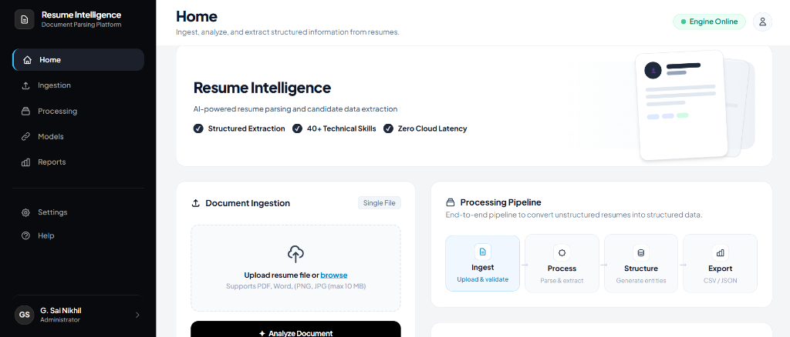

# Resume Intelligence — Enterprise Document Parsing & ATS Scoring Engine

<div align="center">

[](https://resume-intelligence-1f1t.onrender.com)
[](https://github.com/ghantasainikhil7-del/resume-extractor)
[](https://www.python.org/)
[](LICENSE)

### 🌐 **Live Web Application**: [https://resume-intelligence-1f1t.onrender.com](https://resume-intelligence-1f1t.onrender.com)

</div>

---

## 🖥️ Live Demo Preview

<div align="center">
  
  <p><em>Real-time ATS Readiness Scorecard, 5-Pillar Diagnostics, Verified Strengths & Enterprise Compliance Checklist.</em></p>
</div>

---

A production-grade, privacy-first resume intelligence platform that ingests unstructured resumes (PDF, images, and text), executes optical and vector extraction, performs spaCy Named Entity Recognition (NER), benchmarks competencies against a comprehensive 40+ skill taxonomy, and generates multi-pillar ATS scorecards, role alignment matrices, and candidate-tailored screening questions.

---

## 📑 Table of Contents

- [Live Demo Preview](#-live-demo-preview)
- [Executive Summary](#-executive-summary)
- [System Architecture & Processing Pipeline](#-system-architecture--processing-pipeline)
- [5-Pillar ATS Readiness Index & Diagnostics](#-5-pillar-ats-readiness-index--diagnostics)
- [100% Authoritative Role Alignment Matrix (Tab 2)](#-100-authoritative-role-alignment-matrix-tab-2)
- [100% Resume-Tied Screening Questions (Tab 4)](#-100-resume-tied-screening-questions-tab-4)
- [Executive Impact Rewriter (Google X-Y-Z Formula - Tab 3)](#-executive-impact-rewriter-google-x-y-z-formula---tab-3)
- [Export Capabilities & Scorecard Generation](#-export-capabilities--scorecard-generation)
- [Design System & Color Palette](#-design-system--color-palette)
- [Project Directory Structure](#-project-directory-structure)
- [REST API Reference](#-rest-api-reference)
- [Installation & Quickstart](#-installation--quickstart)

---

## 🌟 Executive Summary

Modern enterprise Applicant Tracking Systems (Workday, Greenhouse, Lever, Taleo) employ rigorous deterministic parsers, semantic vector matches, and keyword density thresholds. This platform equips recruiters and engineering candidates with deep visibility into how resumes are digested and ranked:

- **100% Local Execution**: Runs entirely on-device via PyMuPDF C++ vector stream bindings and local spaCy NLP models with **zero cloud latency** and **zero data leakage**.
- **Deterministic 40+ Skill Taxonomy**: Identifies technical proficiencies across Deep Learning, Cloud Infrastructure, Distributed Systems, Full-Stack Frameworks, and Relational Stores.
- **Authoritative Role Alignment**: Verifies 100% exact required skills for standard tech requisitions and isolates critical candidate competency gaps.
- **Resume-Tied Screening Questions**: Synthesizes technical interview questions directly mapped to the candidate's verified resume skills, citing exact resume origins, recruiter evaluation intent, and STAR-model talking points.

---

## ⚙️ System Architecture & Processing Pipeline

```
  [Resume File: PDF / Image / Text]
                  │
                  ▼
   Stage 1: Document Intake & Encoding
     ├── Header inspection & binary validation
     └── Deterministic file categorization
                  │
                  ▼
   Stage 2: Vector Extraction & Optical Fallback
     ├── Primary: PyMuPDF (fitz) native C++ vector stream
     └── Fallback: Tesseract OCR for rasterized/scanned pages
                  │
                  ▼
   Stage 3: Information Extraction & Named Entity Recognition (NER)
     ├── Candidate Name: spaCy `en_core_web_sm` (PERSON entity filtering)
     ├── Direct Coordinates: RFC-compliant Email & E.164 Telephone regex
     └── Digital Footprint: GitHub, LinkedIn, and personal portfolio hyperlinks
                  │
                  ▼
   Stage 4: Taxonomy Mapping & Semantic Enrichment
     ├── 40+ Technical Skills mapped across domains
     ├── Leadership & Action Verbs extraction (70+ tracked verbs)
     └── Quantifiable Impact Detection (%, throughput, scale metrics)
                  │
                  ▼
   Stage 5: Intelligence & Diagnostic Engine
     ├── 5-Pillar ATS Readiness Index (0 - 100 Score & Grade A+ to C)
     ├── 100% Authoritative Role Requisition Alignment Matrix
     ├── Google X-Y-Z Executive Impact Rewriter
     └── 100% Resume-Tied Technical & Behavioral Screening Questions
```

---

## 📊 5-Pillar ATS Readiness Index & Diagnostics

The ATS readiness benchmark computes an aggregate score out of 100 based on five weighted pillars:

| Pillar | Max Weight | Evaluation Criteria |
| :--- | :---: | :--- |
| **01. Contact & Identification Coordinates** | **15 pts** | Formatted candidate name (2+ words), valid professional email, direct telephone number, and verified public profile (LinkedIn/GitHub). |
| **02. Section Architecture & Standard Headers** | **25 pts** | Standard header recognition (*Summary*, *Experience*, *Skills*, *Education*, *Projects*) and document word count balance (ideal: 350–950 words). |
| **03. Keyword Breadth & Taxonomy Coverage** | **25 pts** | Depth of technical competencies extracted against modern engineering frameworks (scaled from 1 to 12+ verified skills). |
| **04. Quantifiable Impact & Leadership Verbs** | **20 pts** | High-impact action verbs (*Architected*, *Spearheaded*, *Optimized*) and measurable business metrics (`%`, `latency`, `throughput`, `cost`). |
| **05. Document Stream & Parsing Readability** | **15 pts** | Absence of null bytes (`\x00`), character encoding anomalies, non-ASCII corruption, and structural legibility. |

### ATS Grading Tiers
- **90 – 100 (Grade A+)**: *ATS Ready (Top 3%)* — Highly competitive, frictionless parsing across Greenhouse, Workday, and Lever.
- **78 – 89 (Grade A)**: *Highly Competitive Fit* — Strong keyword density and chronological structure.
- **68 – 77 (Grade B+)**: *Qualified (Minor Revisions Recommended)* — Solid competencies, needs more quantifiable metric proof.
- **55 – 67 (Grade B)**: *Moderate Alignment* — Missing key section headers or low technical keyword breadth.
- **Below 55 (Grade C)**: *Structural Revisions Required* — Missing contact coordinates or non-standard format.

---

## 🎯 100% Authoritative Role Alignment Matrix (Tab 2)

The **Role Alignment Matrix** benchmarks extracted resume skills against exact, authoritative talent requisition standards:

### Authoritative Requisition Skill Catalog

| Target Requisition Profile | 100% Mandatory Core Competencies | High-Yield Preferred Skills |
| :--- | :--- | :--- |
| **AI / Machine Learning Engineer** | `PYTHON`, `MACHINE LEARNING`, `DEEP LEARNING`, `PYTORCH`, `TENSORFLOW`, `NLP`, `COMPUTER VISION`, `DOCKER`, `GIT` | `KUBERNETES`, `AWS`, `MLOPS`, `SCIKIT-LEARN`, `NUMPY`, `PANDAS`, `REST API`, `LINUX` |
| **Full Stack Software Engineer** | `JAVASCRIPT`, `TYPESCRIPT`, `REACT`, `NODE.JS`, `PYTHON`, `SQL`, `GIT`, `HTML`, `CSS` | `DOCKER`, `POSTGRESQL`, `MONGODB`, `REST API`, `AWS`, `GRAPHQL`, `REDIS`, `CI/CD` |
| **Cloud & DevOps Architect** | `AWS`, `DOCKER`, `KUBERNETES`, `LINUX`, `CI/CD`, `GIT`, `PYTHON` | `AZURE`, `GCP`, `SQL`, `REST API`, `REDIS`, `POSTGRESQL`, `GO` |
| **Data Scientist / Analytics Lead** | `PYTHON`, `SQL`, `PANDAS`, `NUMPY`, `MACHINE LEARNING`, `DATA SCIENCE` | `R`, `TABLEAU`, `POWER BI`, `EXCEL`, `SCIKIT-LEARN`, `POSTGRESQL`, `DEEP LEARNING` |
| **Backend Systems Engineer** | `PYTHON`, `JAVA`, `SQL`, `POSTGRESQL`, `REST API`, `DOCKER`, `GIT` | `REDIS`, `MONGODB`, `C++`, `GO`, `AWS`, `LINUX`, `CI/CD`, `KUBERNETES` |

### Matrix Features
- **Mandatory Competencies Grid**: Renders every required skill with an immediate status chip (`✓ In Resume` with `PASSED` or `⚠️ Missing Gap` with `REQUIRED`).
- **Real-Time Coverage Metric**: Displays verified coverage count and percentage (e.g. `7 / 9 Core Competencies Validated (78%)`).
- **Keyword Actionability**: Missing competencies are clickable for 1-click clipboard copying so candidates can weave missing keywords into their milestone descriptions.
- **Dynamic Custom Role Evaluation**: Allows evaluating any arbitrary target title (e.g., *Platform Engineer*, *Site Reliability Engineer*) via on-demand heuristic keyword matching.

---

## 💡 100% Resume-Tied Screening Questions (Tab 4)

Screening questions are synthesized with strict 100% provenance:

1. **Exact Resume Attribution**: Every question cites the exact skill extracted from the candidate's resume (e.g. `Validated in Resume: PYTORCH`).
2. **Requisition Demand Vector**: Connects the skill directly to the role requirement (e.g. `Mandatory Deep Learning Training & Inference Vector`).
3. **Engineering Depth**: Questions test production reality—not basic textbook definitions:
   - **PyTorch**: Probes mixed-precision (`torch.cuda.amp`), gradient checkpointing for OOM prevention, and `DistributedDataParallel` vs `DataParallel`.
   - **Docker**: Inquires about multi-stage Dockerfiles with CUDA base images to reduce final image size from 15GB+ down to lean production artifacts.
   - **Kubernetes**: Tests Pod Disruption Budgets, Horizontal Pod Autoscalers (HPA) using custom Prometheus metrics, and Canary deployment traffic shaping.
   - **PostgreSQL**: Probes transaction isolation levels, row-level locking (`SELECT FOR UPDATE`), and PgBouncer connection pooling under spike loads.
4. **Recruiter Verification Intent**: Explains the technical motivation behind the interviewer's question.
5. **STAR-Model Talking Points**: Guides candidates through **S**ituation, **T**ask, **A**ction, and **R**esult.
6. **Live Role Switching**: Selecting any role in the Role Alignment Matrix dynamically re-renders screening questions to match that requisition and the candidate's verified competencies.

---

## ✍️ Executive Impact Rewriter (Google X-Y-Z Formula - Tab 3)

Transforms generic operational duties into high-impact executive milestone statements using the formula:
$$\text{Accomplished [X], as measured by [Y], by doing [Z]}$$

Generates three distinct stylistic variations:
1. **Scale & Quantitative Impact**: Highlights throughput, latency reduction, cost savings, and scale.
2. **Architecture & Engineering Rigor**: Emphasizes system availability, zero-downtime reliability, and code standards.
3. **Optimization & Cross-Functional Velocity**: Focuses on developer velocity, pipeline automation, and engineering hours saved.

---

## 📄 Export Capabilities & Scorecard Generation

- **Printable ATS Readiness Scorecard**: One-click printable report (`window.print()`) formatted with clean executive styling, score badge, pillar breakdown, and validated competency inventory.
- **Structured ATS JSON**: Full machine-readable payload containing candidate metadata, NLP confidence, ATS scores, checklist results, role matching, and interview questions.
- **Recruiter CSV**: Standard flat CSV format ready for bulk recruitment import into enterprise databases.

---

## 🎨 Design System & Color Palette

The interface adheres to an enterprise design system:

| Color Token | Hex Code | Visual Application |
| :--- | :--- | :--- |
| **Obsidian Dark** | `#080A0E` | Left sidebar background, primary CTAs, score badges |
| **Dark Slate** | `#0F172A` | Primary typography, headers, metric circle gauge |
| **Canvas Background** | `#F4F5F7` | Workspace canvas background |
| **Card Surface** | `#FFFFFF` | Structured content cards, modal windows |
| **Subtle Border** | `#E6E8EC` | Card dividing lines, outer containers |
| **Electric Cyan** | `#38BDF8` | Active navigation indicator bar, pulsating status pings |
| **Emerald Accent** | `#10B981` | Passed compliance items, verified resume skill chips |

- **Zero Cartoon Emojis**: Clean 14px monochrome SVG stroke icons throughout.
- **Typography**: [Plus Jakarta Sans](https://fonts.google.com/specimen/Plus+Jakarta+Sans) for clear modern UI text and [JetBrains Mono](https://fonts.google.com/specimen/JetBrains+Mono) for IDs, code tokens, and metrics.

---

## 📁 Project Directory Structure

```
resume_extractor/
├── app.py                     # Flask web server, file upload handling & REST API
├── ats_scorer.py              # ATS scoring algorithm, JOB_PROFILES & question bank
├── resume_extractor.py        # PyMuPDF vector extraction & Tesseract OCR engine
├── resume_parser.py           # spaCy NER entity classification & skill extraction
├── main_runner.py             # Batch CLI runner for processing corpora
├── requirements.txt           # Python dependency definitions
├── templates/
│   └── index.html             # Enterprise Tailwind web dashboard & interactive tabs
├── output/                    # Generated batch CSV/JSONL extracts
│   ├── resume_data.csv
│   └── resumes.jsonl
└── tests/
    ├── test_extractor.py      # Unit tests for text extraction
    └── test_parser.py         # Unit tests for NER & entity parsing
```

---

## 🔌 REST API Reference

### 1. Ingest & Analyze Resume
- **Endpoint**: `POST /api/parse`
- **Payload**: `multipart/form-data` with `resume: <File>`
- **Response**:
```json
{
  "success": true,
  "result": {
    "candidate_id": "CAND-8F32A1",
    "name": "Alex Morgan",
    "email": "alex.morgan@email.com",
    "phone": "+1 (555) 123-4567",
    "skills": ["Python", "PyTorch", "Docker", "Git", "SQL"],
    "ats_score": 92,
    "confidence_score": "98.6%",
    "ats_analysis": { ... }
  }
}
```

### 2. Match Custom Role
- **Endpoint**: `POST /api/role_match`
- **Payload**: `application/json`
```json
{
  "role": "Platform Engineer",
  "skills": ["Python", "Docker", "Kubernetes", "AWS"]
}
```
- **Response**: Returns `match_percentage`, `all_required_skills`, `matched_skills`, `missing_skills`, and dynamic `screening_questions`.

### 3. Enhance Bullet Point
- **Endpoint**: `POST /api/enhance_bullet`
- **Payload**: `application/json`
```json
{
  "bullet": "Built machine learning pipelines for customer churn",
  "skills": ["Python", "PyTorch"]
}
```
- **Response**: Returns 3 structured variations following the Google X-Y-Z formula.

### 4. Health Check
- **Endpoint**: `GET /api/health`
- **Response**: Operational status of PyMuPDF, spaCy, and Tesseract engines.

---

## 🚀 Installation & Quickstart

### Prerequisites
- Python 3.10+
- (Optional for scanned image fallback) Tesseract OCR

### Step 1: Clone & Setup Virtual Environment
```bash
cd resume_extractor
python -m venv .venv
```

Activate the virtual environment:
- **Windows**: `.venv\Scripts\activate`
- **Linux / macOS**: `source .venv/bin/activate`

### Step 2: Install Dependencies & Language Models
```bash
pip install -r requirements.txt
python -m spacy download en_core_web_sm
```

### Step 3: Run the Application
```bash
python app.py
```
Open [http://localhost:5000](http://localhost:5000) in your web browser.

### Step 4: Run Batch Processing (CLI)
To parse an entire directory of resumes into structured CSV and JSONL files:
```bash
python main_runner.py
```

---

## 📄 License
Released under the [MIT License](LICENSE).
